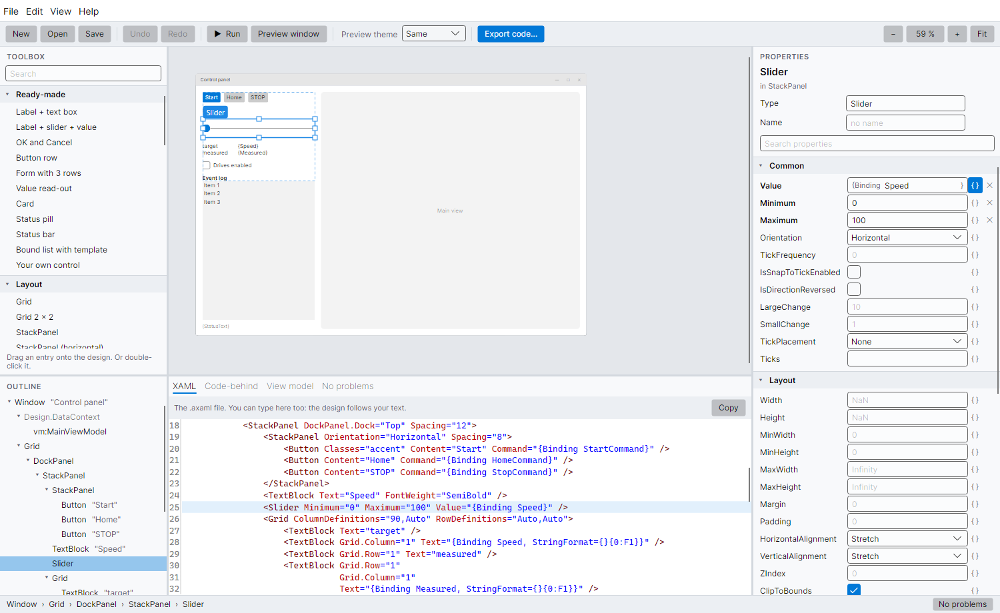

# Avalonia Builder

An experimental "visual designer" app draft for Avalonia views.

You do not have to remember the syntax. You can read the code while you build (kind of a way to learn it).



## Start

You need the .NET 10 SDK.

```
dotnet run --project src/AvaloniaBuilder
```

On Windows you can also double-click `run.cmd`.

Also this:

```
dotnet run --project src/AvaloniaBuilder -- C:\path\to\MainWindow.axaml
```

## Tests

```
dotnet test
```

```
dotnet test --filter "Category!=Slow"
```

The UI tests save pictures of the window to `artifacts/screens`.

## Versions

Avalonia 12.1.6, CommunityToolkit.Mvvm 8.4.2, .NET 10 (exported projects use the same versions).
